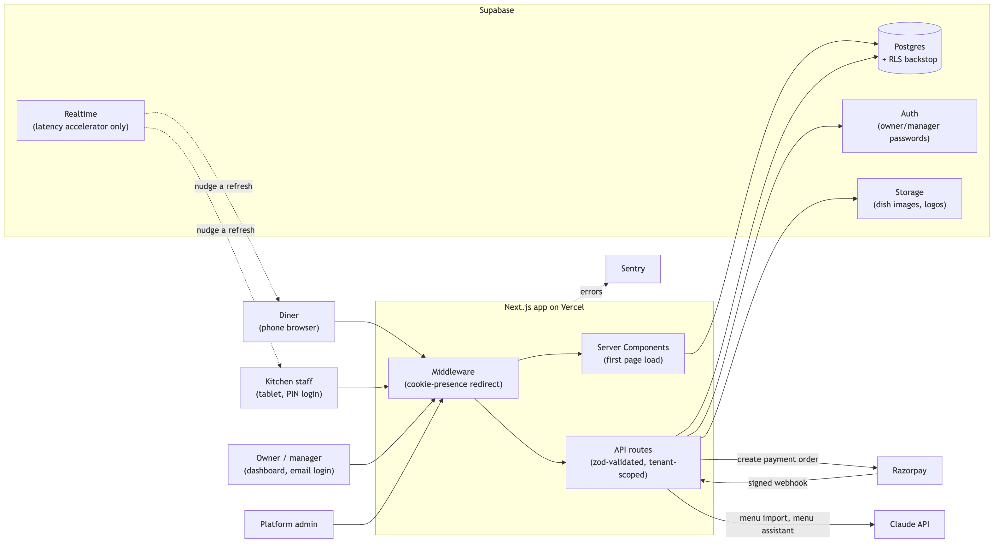
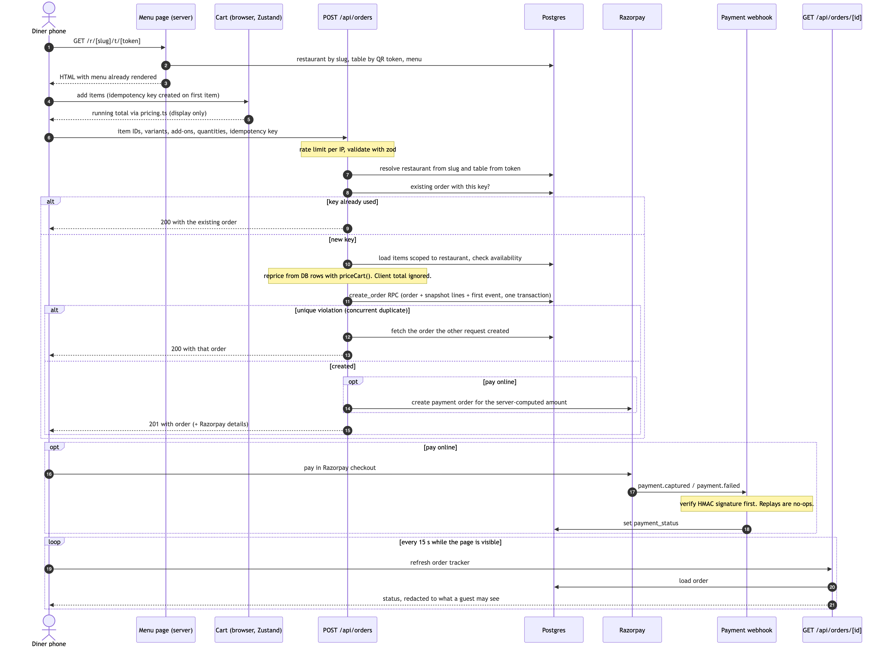
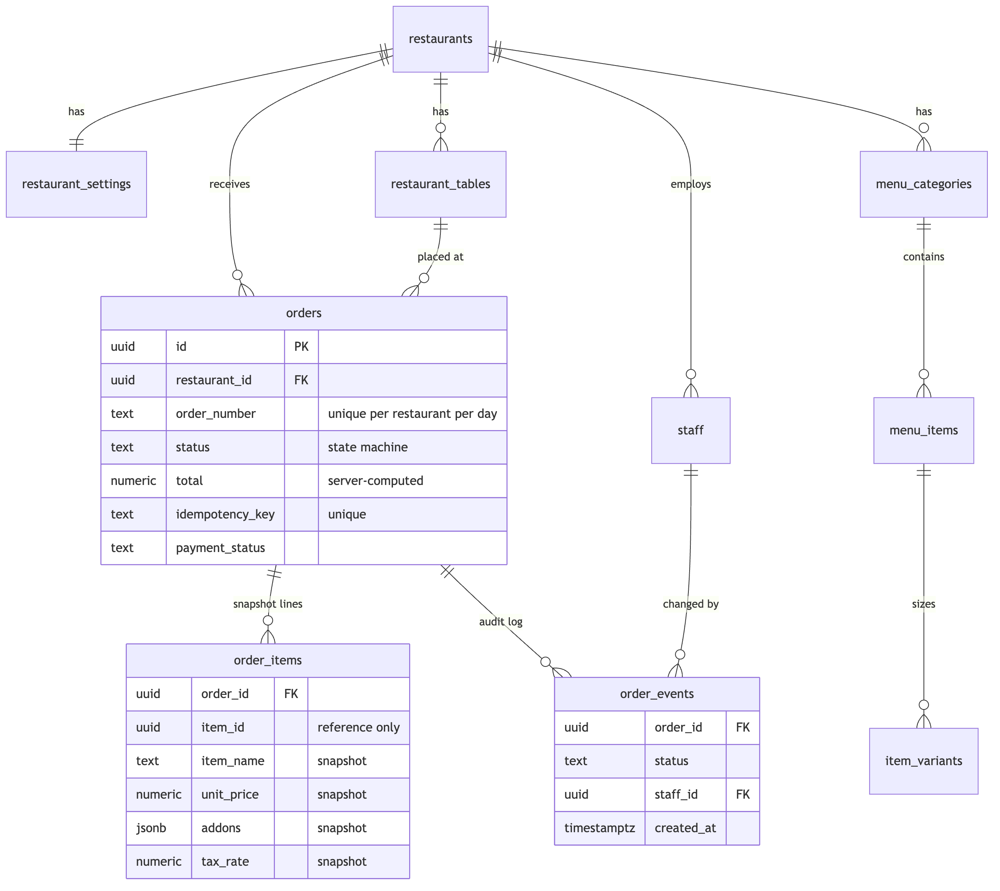

# QBite — QR Restaurant Ordering Platform

A multi-tenant web app where customers scan a QR code at their table, browse the menu, and place orders — no app install, no login. Orders reach the kitchen display within seconds. One deployment, many restaurants.

---

## Features

### Customer
- Scan QR → live menu, no login required
- Category tabs with scroll-spy, search, and filters (veg-only, price, bestsellers)
- Variants and add-ons per item (Half / Full, extra cheese, etc.)
- Cart with per-item notes, item stepper, bill breakdown
- Checkout: name + phone, then Cash or Razorpay
- Live order status tracker: Placed → Accepted → Preparing → Ready → Served
- **AI menu assistant** — ask "something spicy and veg?" or "कुछ मीठा?" and get tappable dish suggestions, in the diner's own language
- **हिंदी menu** — one tap switches the menu to Hindi wherever the restaurant has translations

### Restaurant
- **Kitchen display** — live order cards, sound alert on new order, one tap to advance status, amber/red urgency timers
- **Menu manager** — add/edit/delete categories and items, drag to reorder, one-tap availability toggle
- **AI menu import** — upload up to 5 photos or PDFs of a printed menu; pages are read in parallel, AI drafts the dishes, code flags duplicates and anything it couldn't read, and the owner reviews before anything is saved (close the dialog and continue later)
- **AI descriptions & Hindi** — AI writes missing English descriptions and translates dish names and descriptions into Hindi; anything with a health or allergy claim is rewritten or dropped; the owner reviews before saving
- **Table manager** — QR standee PDF generator (branded, table-numbered)
- **Dashboard** — today's order count, revenue, average ticket
- **Ask AI** — owners ask "How were sales today?" or "Which dishes didn't sell?" right in the dashboard, on any phone; read-only
- **Ask Claude about your restaurant (MCP)** — create a personal access token in Settings and connect Claude Desktop or Claude Code; read-only tools for sales, orders, best sellers and dishes that don't sell (same tools, for technical users)
- **Staff login** — email (owner/manager) or 4-digit PIN (kitchen/waiter)

### Platform
- Super-admin panel to onboard and manage restaurants

---

## Design Decisions

How the system works and why. **[Architecture overview →](docs/architecture.md)** (diagrams, flows, scaling limits, failure modes) · **[UML diagrams →](docs/uml.md)** (13 diagrams: use case, class, component, deployment, state machine, activity, sequence)

| Problem | Decision | ADR |
|---|---|---|
| Many restaurants, one deployment, zero data leaks | Shared Postgres; server-derived `restaurant_id` on every query, RLS as backstop | [0001](docs/adr/0001-shared-database-multi-tenancy.md) |
| A tampered request or a menu price change must never alter a bill | Server reprices every order; order lines snapshot name and price | [0002](docs/adr/0002-server-side-pricing-and-snapshots.md) |
| Flaky networks cause double orders | Client idempotency key + unique constraint, race-safe | [0003](docs/adr/0003-idempotent-order-creation.md) |
| Several devices update one order | One-way state machine, compare-and-set, audit log | [0004](docs/adr/0004-order-state-machine.md) |
| Short order numbers broke on day two | Day-scoped uniqueness + per-restaurant advisory lock | [0005](docs/adr/0005-daily-order-numbers.md) |
| PIN login on shared tablets, instant revocation | Signed cookie for identity, staff row checked every request | [0006](docs/adr/0006-staff-sessions.md) |
| Realtime silently delivered nothing to staff | Tenant-scoped polling; Realtime only nudges | [0007](docs/adr/0007-kitchen-board-polling.md) |
| Kitchen wifi drops | Optimistic updates, persisted queue, server wins | [0008](docs/adr/0008-offline-kitchen-display.md) |
| LLMs can be wrong or manipulated | AI drafts and suggests; code validates; humans approve writes | [0009](docs/adr/0009-ai-as-untrusted-component.md) |
| Multi-page menu import with a human review that can last hours | LangGraph workflow: parallel page reads, checkpointed pause for owner review, server-side validation | [0010](docs/adr/0010-menu-import-langgraph.md) |
| AI-written text must never make a health claim, in any language | Guardrail check is a graph edge: failing text is rewritten (max 3 calls), then dropped and flagged; translations in their own table | [0011](docs/adr/0011-ai-dish-writing-and-translations.md) |
| Let owners ask an AI app about their restaurant, safely | MCP server with hashed personal tokens re-checked every request; read-only tools; tenant from the token; no customer PII | [0012](docs/adr/0012-owner-mcp-server.md) |
| AI must not make up or mis-state numbers | Code checks every figure in an answer against the tool data (and recomputes differences and % changes); one retry, then a visible warning; sources shown under each answer | [0013](docs/adr/0013-grounded-owner-answers.md) |

### System at a glance

**Architecture**: what runs where, and the trust boundary between browser and server.



**Placing an order**: server-side repricing, the idempotency fast path and race backstop, and payment.



**Data model**: every tenant table hangs off `restaurants`; order lines are snapshots.



All UML diagrams, including the kitchen and restaurant-owner flows, are in [uml.md](docs/uml.md). The narrative, scaling limits and failure modes are in [architecture.md](docs/architecture.md).

---

## Tech Stack

| Layer | Choice |
|---|---|
| Framework | Next.js 14 (App Router, RSC) |
| Language | TypeScript (strict) |
| Styling | Tailwind CSS + shadcn/ui |
| Database | Supabase (Postgres + RLS) |
| Auth | Supabase Auth + custom PIN login |
| Realtime | Polling + Supabase Realtime as an accelerator |
| Storage | Supabase Storage |
| Payments | Razorpay |
| State | Zustand (cart) + TanStack Query (server state) |
| AI | Claude API (`@anthropic-ai/sdk`) — server-side only |
| AI orchestration | LangGraph (menu import and dish-writing workflows; Claude still called via the Anthropic SDK) |
| AI integrations | MCP server (`@modelcontextprotocol/sdk`, Streamable HTTP) for owners |
| Rate limiting | Upstash Redis (shared across serverless instances; in-memory fallback) |
| Caching | Next.js Data Cache for the public menu, cleared by tag on every menu write |
| Error tracking | Sentry |
| Deployment | Vercel |

---

## Quick Start

### 1. Clone and install

```bash
git clone <repo-url>
cd restroMenu
npm install
```

### 2. Environment variables

```bash
cp .env.example .env.local
```

Fill in `.env.local`. [`.env.example`](.env.example) lists every variable with a comment; the groups are:

| Group | Variables | Needed for |
|---|---|---|
| Supabase | `NEXT_PUBLIC_SUPABASE_URL`, `NEXT_PUBLIC_SUPABASE_ANON_KEY`, `SUPABASE_SERVICE_ROLE_KEY` (server-only) | Everything |
| Sessions & admin | `SESSION_SECRET`, `SUPER_ADMIN_SECRET` | Staff and super-admin login |
| Payments | `RAZORPAY_KEY_ID`, `RAZORPAY_KEY_SECRET`, `RAZORPAY_WEBHOOK_SECRET`, `NEXT_PUBLIC_RAZORPAY_KEY_ID` | Online payments |
| AI | `ANTHROPIC_API_KEY` (server-only) | All AI features |
| AI kill switches | `AI_MENU_ONBOARDING_ENABLED`, `AI_MENU_ASSISTANT_ENABLED`, `AI_MENU_WRITING_ENABLED`, `AI_OWNER_ASSISTANT_ENABLED`, `AI_OWNER_MCP_ENABLED` | Set any to `"false"` to turn that feature off without a deploy |
| AI workflow state | `DATABASE_URL` (Supabase **pooled** connection string, port 6543) | Pausing and resuming AI menu import / dish writing (LangGraph checkpoints). Unset = in memory, fine for local dev |
| Rate limiting | `UPSTASH_REDIS_REST_URL`, `UPSTASH_REDIS_REST_TOKEN` | Shared rate limits on serverless. Unset = per-instance in-memory limits |
| Monitoring | `NEXT_PUBLIC_SENTRY_DSN`, `SENTRY_ORG`, `SENTRY_PROJECT`, `SENTRY_AUTH_TOKEN` | Error tracking |

Without `ANTHROPIC_API_KEY` the app works normally: the AI buttons are hidden and AI routes return a clear "not configured" error.

### 3. Database setup

In the Supabase SQL editor, run in order:
1. `docs/schema.sql` — creates all tables, RLS policies, functions
2. `docs/seed.sql` — seeds one demo restaurant (`test-kitchen`) with tables, categories, and menu items

Already set up from an earlier version? Run the files in `docs/migrations/` you haven't run yet, in number order (009–011 are the AI ones).

### 4. Run

```bash
npm run dev
```

Open [http://localhost:3000](http://localhost:3000)

---

## Demo Credentials

| Role | How to access |
|---|---|
| Customer | `http://localhost:3000/r/test-kitchen/t/demo-t1-8c6c8c72d282750c` |
| Owner / Manager | `http://localhost:3000/login` → click **Use Demo** |
| Super admin | `http://localhost:3000/admin/login` → click **Use Demo** |

Demo restaurant login: `testowner@qbite.dev` / `Test1234!`

---

## Key Routes

| Route | Who |
|---|---|
| `/r/[slug]/t/[token]` | Customer — menu & ordering |
| `/r/[slug]/t/[token]/cart` | Customer — cart review |
| `/r/[slug]/t/[token]/checkout` | Customer — checkout |
| `/order/[orderId]` | Customer — live order tracker |
| `/login` | Staff login (email or PIN) |
| `/dashboard` | Restaurant dashboard |
| `/dashboard/kitchen` | Kitchen display |
| `/dashboard/menu` | Menu manager |
| `/dashboard/tables` | Table & QR manager |
| `/dashboard/orders` | Order history |
| `/dashboard/reports` | Sales reports (owner, manager) |
| `/dashboard/assistant` | **Ask AI** about your restaurant (owner, manager) |
| `/dashboard/staff` | Staff and PINs (owner, manager) |
| `/dashboard/settings` | Settings, incl. **AI access (MCP)** tokens (owner) |
| `/api/mcp` | MCP server for Claude Desktop / Claude Code (personal access token) |
| `/admin/login` | Platform super-admin login |
| `/admin/restaurants` | Manage all restaurants |

---

## Project Structure

```
src/
  app/
    (customer)/r/[slug]/t/[token]/   # Customer menu, cart, checkout
    (customer)/order/[orderId]/      # Order tracker
    dashboard/                       # Restaurant staff pages
    admin/                           # Platform admin
    api/                             # API routes
  components/
    menu/          # MenuHeader, MenuItemCard, CartBar, CategoryTabs…
    cart/          # CartLineItem, BillSummary…
    checkout/      # CheckoutForm
    kitchen/       # KitchenBoard, OrderCard…
    dashboard/     # Analytics, Staff, Tables…
    menu-manager/  # Menu manager, AI import dialog, AI descriptions & Hindi dialog
    assistant/     # Ask AI chat (owner dashboard)
    settings/      # Settings form, AI access (MCP) tokens
    admin/         # Super-admin components
    ui/            # shadcn/ui primitives + custom atoms
  lib/
    ai/            # AI features (server-only, except draft.ts)
      client.ts              # Anthropic client, model per feature, refusal fallback
      guardrails.ts          # Shared guardrails: rate limits, kill switches, input/output checks, chat history
      menu-extract.ts        # The one Claude call behind menu import (also scored by the eval)
      menu-onboarding.ts     # Extraction schema + checks against the existing menu
      menu-import-graph.ts   # LangGraph: parallel page reads → merge → review pause → validate
      dish-writing.ts        # Claude call + guardrail check for descriptions & Hindi
      menu-writing-graph.ts  # LangGraph: per-dish write → check → retry subgraph, review pause
      workflow-checkpointer.ts # Postgres (or in-memory) checkpoints for paused workflows
      menu-assistant.ts      # Diner menu assistant agent and its read-only tools
      owner-assistant.ts     # Ask AI agent for owners (shared owner tools)
      grounding.ts           # Checks every figure in an Ask AI answer against the tool data
      draft.ts               # Client-safe "is this imported dish ready to save" rule
    mcp/           # Owner tools (defined once), MCP server, scoped data queries
    access-tokens.ts # Personal access tokens: generate, hash, verify
    rate-limit.ts  # Upstash Redis rate limiter with in-memory fallback
    pricing.ts     # All money math — the only place arithmetic on prices happens
    queries/       # Supabase data fetching
    mappers.ts     # DB row → TS type (snake_case → camelCase)
    auth.ts        # Session helpers
  store/
    cart.ts        # Zustand cart store (persisted to localStorage)
  types/
    index.ts       # Shared TypeScript types — mirror the DB schema exactly
docs/
  schema.sql       # Database schema + RLS policies
  seed.sql         # Demo data
  api-spec.md      # API endpoint contracts
  ui-spec.md       # Screen & component spec
  tasks.md         # Build task list
  adr/             # Architecture decision records (0001–0013)
evals/
  menu-extract/    # Menu import eval: hand-labelled menus, scorer, report
```

---

## Commands

| Command | Purpose |
|---|---|
| `npm run dev` | Start development server |
| `npm run build` | Production build |
| `npm run typecheck` | TypeScript check (no emit) |
| `npm run test` | Vitest unit tests |
| `npm run check` | typecheck + lint + test |
| `npm run eval:menu` | Score AI menu import against hand-labelled menus (cached; re-runs the model only when the prompt, schema or model changes) |

---

## Architecture Notes

**Multi-tenancy** — Every Supabase query on a tenant table must include `.eq('restaurant_id', restaurantId)`. RLS policies are a backstop, not the primary defence. `restaurantId` always comes from the server (slug lookup or authenticated session), never from a client-supplied field.

**Money** — All pricing arithmetic lives in `src/lib/pricing.ts`. The server recomputes order totals from item IDs; any total sent in a request body is ignored.

**Orders** — Status moves one way: `placed → accepted → preparing → ready → served`. `cancelled` is reachable before `served`. Every transition is recorded in `order_events`. Order creation requires a client-generated idempotency key — duplicates return the existing order with 200.

**Cart** — Zustand store persisted to `localStorage`, scoped per `(restaurant_slug, table_id)`. Cart data is never trusted server-side for pricing.

**AI features** — The model is treated as an untrusted component ([ADR 0009](docs/adr/0009-ai-as-untrusted-component.md)): it drafts and suggests, code checks everything it returns, and people approve every write. Five features share the rules in `src/lib/ai/guardrails.ts`:

| Feature | Pattern | What keeps it correct |
|---|---|---|
| Diner menu assistant | Tool-using agent (Anthropic SDK tool runner), 3 read-only tools | Suggested dishes re-validated against this restaurant's live menu; prices only from the database |
| AI menu import | **LangGraph** workflow: parallel page reads → merge → owner review (pause/resume) → validate | Code checks prices, duplicates and the veg rule; owner approves; scored by an eval |
| Descriptions & Hindi | **LangGraph**: per-dish write → check → rewrite subgraph | Health claims (English and Hindi), prices and non-Devanagari names rewritten, at most 3 tries, then dropped |
| Ask AI (owners) | Tool-using agent over 4 read-only owner tools | **Every figure checked in code** against the tool data, incl. recomputed differences and % changes; one retry, then a visible warning |
| MCP server (owners) | The same 4 tools over MCP, personal access tokens | Tokens hashed and re-checked every request; restaurant from the token |

Shared by all of them:
- **Read-only, tenant-scoped tools.** The restaurant comes from the slug and table token, the staff session or the access token, resolved on the server. No tool input can choose a restaurant.
- **Nothing the model says is trusted:** IDs are re-validated, money comes from the database, and claims are filtered.
- **No invented health claims**, in English or Hindi. The menu has no allergen data, so diners are told to ask staff.
- **Untrusted input is fenced as data**, length-capped and stripped of control characters. Uploads are checked by their real bytes.
- **No customer names or phone numbers** reach any owner-facing AI tool.
- **Rate-limited and switchable.** Per-IP, table, staff, token and restaurant limits, plus a kill switch per feature. Logs record counts and token usage only.

**Rate limiting** — Counters live in Upstash Redis, so every serverless instance shares them. If Redis is down or slow, a request falls back to a per-instance limit and logs it: weaker for a moment, never unlimited.

**Caching** — The public menu (read on every scan, cart, checkout and chat message) is cached for 60 s and cleared by tag on every menu write. The cache key is versioned (`public-menu:v2`): bump it whenever the cached shape changes. Prices for orders, order status, sessions and payments are never cached.

**Kitchen board** — Polls a tenant-scoped server route every 8 s; Supabase Realtime only triggers an earlier poll, because staff cookie sessions aren't visible to RLS. Optimistic status updates queue to `localStorage` when offline and sync on reconnect. See [ADR 0007](docs/adr/0007-kitchen-board-polling.md).

---

## AI Quality: Measured, Not Assumed

AI menu import is scored by an eval (`npm run eval:menu`): 10 real menus, 270 hand-labelled dishes, the same code as production, scored before and after the code checks.

| Metric | Result |
|---|---|
| Dish precision / recall | **100%** / **95.9%** |
| Prices correct | **98.1%**; **0** invented |
| Non-veg dishes marked veg | **0** |

Details, per-menu results and known misses: [evals/menu-extract/report.md](evals/menu-extract/report.md).

---

## Five Things That Break This App If Done Wrong

1. A query missing `restaurant_id` leaks another restaurant's data.
2. Trusting a client-supplied total lets anyone order a biryani for ₹1.
3. Joining to `menu_items` to price a past order rewrites history when prices change.
4. A missing idempotency key turns a double-tap into two orders and one angry table.
5. A kitchen screen that doesn't survive a wifi drop gets unplugged by day three.

---

## User Guide

### For Customers

#### Placing an order
1. Scan the QR code on your table with any phone camera — no app needed.
2. The menu opens in your browser. Browse categories using the tabs at the top.
3. Tap an item to see details, variants (size), and add-ons. Adjust the quantity and tap **Add to Cart**.
4. The cart bar at the bottom shows your running total. Tap **View Cart** when ready.
5. Review your items, adjust quantities or remove anything, then tap **Proceed to Checkout**.
6. Enter your name and phone number. Choose **Cash** (pay at the table) or **Pay Online** (Razorpay).
7. After placing, you land on the **Order Tracker** page. Refresh or keep it open — the status updates live.

#### Order statuses
| Status | Meaning |
|---|---|
| Placed | Restaurant received your order |
| Accepted | Staff confirmed it |
| Preparing | Kitchen is cooking |
| Ready | Your food is on its way |
| Served | Done — enjoy! |

#### Asking the menu assistant
1. Tap **Ask AI** in the filter row (or **Ask the menu assistant** when a search finds nothing).
2. Type what you feel like — a flavour, a budget, "for two", in any language — or tap a suggestion.
3. Tap a suggested dish to open it, choose size and add-ons, and add it to your cart as usual.

The assistant can't place orders, change your cart, or confirm allergens. For allergies or dietary needs, ask the staff.

#### Reading the menu in Hindi
If the restaurant has added Hindi, a **हिं** button appears at the top of the menu. Tap it to switch dish names and descriptions to Hindi, and tap **EN** to switch back. Dishes without a translation stay in English, and search works in both languages.

#### Tips
- Out-of-stock items appear faded and cannot be added.
- Use the **Veg only** filter to hide non-veg items.
- Add a note to any item ("less spicy", "no onion") in the detail sheet before adding to cart.

---

### For Restaurant Staff — Manager / Owner Login

#### Logging in
1. Go to `/login` (or scan the staff QR).
2. Choose **Manager / Owner** tab, enter your email and password, tap **Sign In**.
3. You land on the Dashboard.

#### Dashboard
- Shows today's order count, revenue, and average ticket in real time.
- Use the sidebar to navigate to Kitchen, Menu, Tables, Orders, and Settings.

#### Menu Manager (`/dashboard/menu`)
1. **Add a category** — click **+ Category**, enter a name, save.
2. **Add an item** — click **+ Item** inside a category. Fill in name, price, description, food type (veg/non-veg/egg), image, and optionally variants and add-on groups.
3. **Reorder** — drag any category or item to a new position.
4. **Toggle availability** — flip the switch on any item to mark it out of stock. Customers see it greyed out immediately.
5. **Edit / Delete** — use the kebab menu (⋮) on any item or category.
6. **Import a menu with AI** — click **Import with AI** and upload up to **5** clear photos or PDFs of your printed menu (JPG, PNG, WebP or PDF, up to 10 MB each). Pages are read at the same time and merged into one draft; a page that can't be read is reported by number. You can close the dialog and choose **Continue your last import** later. Then review the draft:
   - Dishes already on your menu are unticked, and existing categories are reused rather than duplicated.
   - Dishes marked **Needs your input** are missing a price or a veg/non-veg/egg marker — fill them in; **Import** stays disabled until you do.
   - Descriptions labelled **AI draft** were written by AI because none was printed — check them.
   - If a dish shows sizes (e.g. Half / Full), add them as variants after importing.
   - Nothing is saved until you click **Import**.
7. **Descriptions & Hindi with AI** — click **Descriptions & Hindi**. Dishes missing a description or Hindi are ticked for you (up to 40). AI writes an English description for dishes that have none, and the Hindi name and description for each. Text that makes a health or allergy claim is rewritten automatically, or removed and flagged. Review and edit English and Hindi side by side, then **Save**. You can close and continue later.

#### Ask AI (`/dashboard/assistant`)
Ask about your restaurant in plain words, on any phone: "How were sales today?", "Compare today with yesterday", "Top 5 dishes this week", "Which dishes haven't sold in 2 weeks?", "Show active orders".
- Under each answer, **Based on** shows the data it used, linking to the page where you can check it.
- **✓ Figures checked against your data** means every number matched. If a number couldn't be checked, the answer says so and points you to Sales reports.
- It's read-only: it can't change your menu, prices or orders. For things QBite doesn't record (profit, stock, staff hours) it tells you so instead of guessing.

#### Ask Claude from your own AI app (MCP, optional)
For owners who use Claude Desktop or Claude Code: **Settings → AI access (MCP) → Create token**, then copy the setup command or config shown (it's shown once). Revoke a token any time; it stops working on the next request. Claude on the web and ChatGPT need an OAuth sign-in, which isn't supported yet, so use **Ask AI** in the dashboard instead.

#### Table Manager (`/dashboard/tables`)
1. **Add a table** — click **+ Table**, enter a label (e.g. "T1", "Patio 3").
2. **Download QR standee** — click the QR icon next to any table to download a print-ready PDF with the restaurant name, table label, and scannable QR code. Print and laminate it.
3. **Regenerate QR** — if a token is compromised, regenerate it here. The old QR stops working immediately.

#### Order History (`/dashboard/orders`)
- Browse all past orders filtered by date or status.
- Click any order to see the full bill with item snapshots, add-ons, and payment method.

---

### For Kitchen Staff — PIN Login

1. Go to `/login`, choose **Kitchen / Waiter** tab.
2. Type your restaurant code (slug, e.g. `test-kitchen`), select your name, enter your 4-digit PIN.
3. You are taken directly to the Kitchen Display.

#### Kitchen Display (`/dashboard/kitchen`)
- New orders animate in at the top-left with a chime sound.
- Each card shows: **order number**, **table**, **elapsed time**, all **items with quantity and notes**.
- Card border turns **amber** after 15 minutes, **red** after 25.
- Tap the primary button on a card to advance its status:
  - **Accept** → **Start Preparing** → **Mark Ready**
- To cancel an order, use the kebab menu (⋮) on the card.
- If the internet drops, a banner shows "Offline — N changes pending". Status changes are saved locally and sync automatically when connection returns.

---

### For Platform Super-Admin

#### Logging in
Go to `/admin/login` and enter the super-admin secret.

#### Onboarding a restaurant
1. Go to **Restaurants** → **+ New Restaurant**.
2. Fill in: name, slug (URL-safe, e.g. `spice-garden`), timezone, currency.
3. Save — the restaurant is created with a default "open" status.
4. Share the staff login URL (`/login?slug=spice-garden`) with the owner.
5. The owner sets up their menu, tables, and staff PINs from the dashboard.

#### Managing restaurants
- **Activate / Deactivate** — deactivating hides the restaurant's menu from customers immediately.
- Click a restaurant row to view its order volume and settings.

---

## License

Private — all rights reserved.
