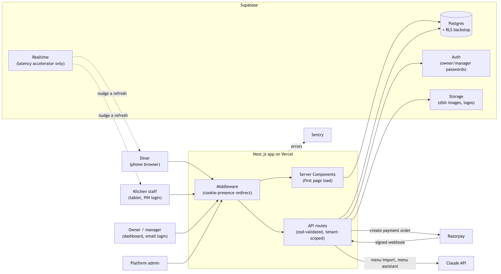
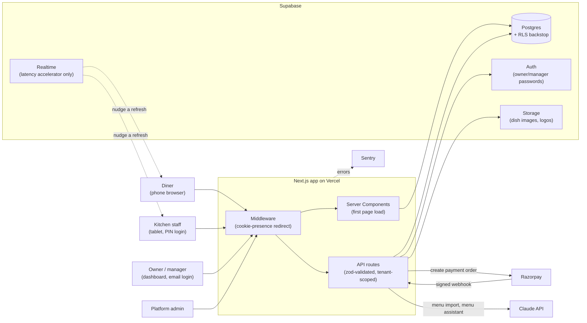
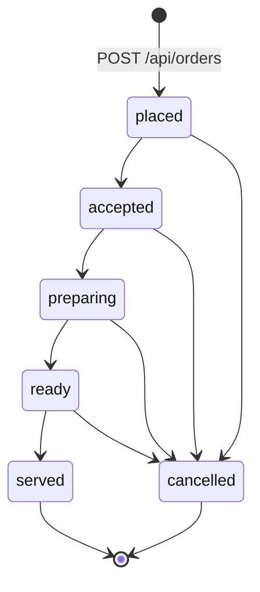
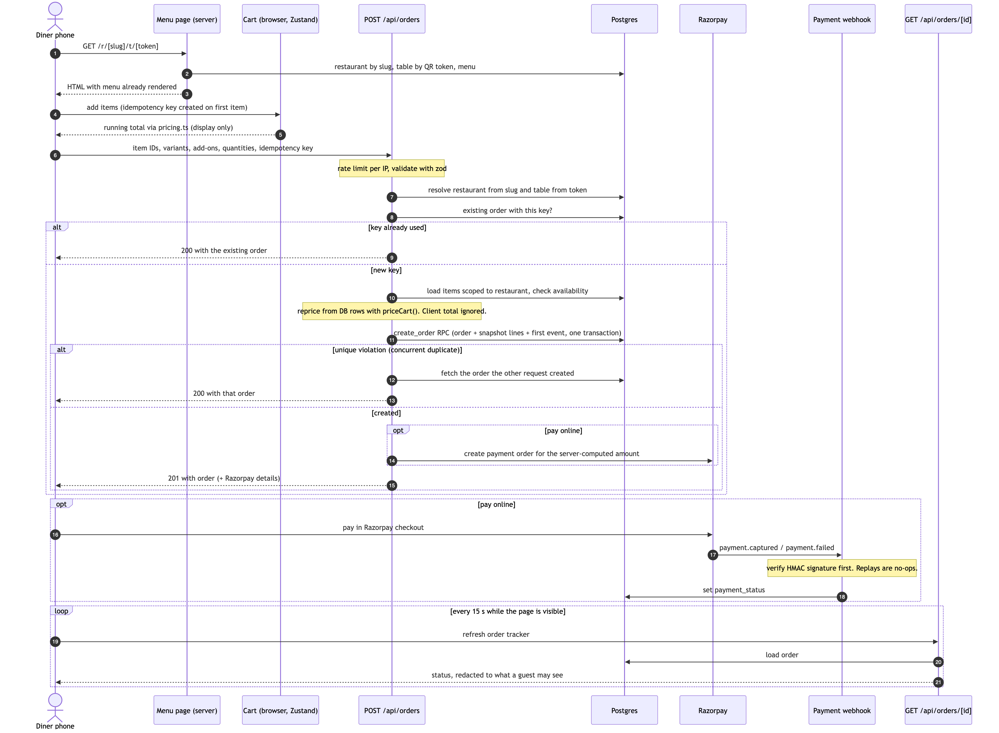
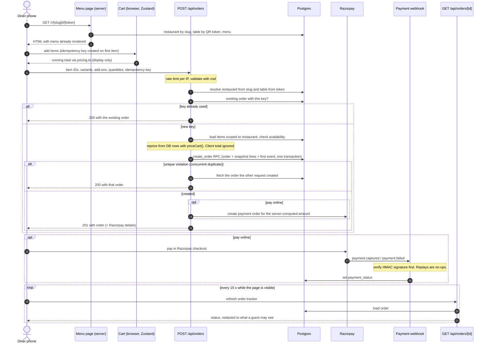
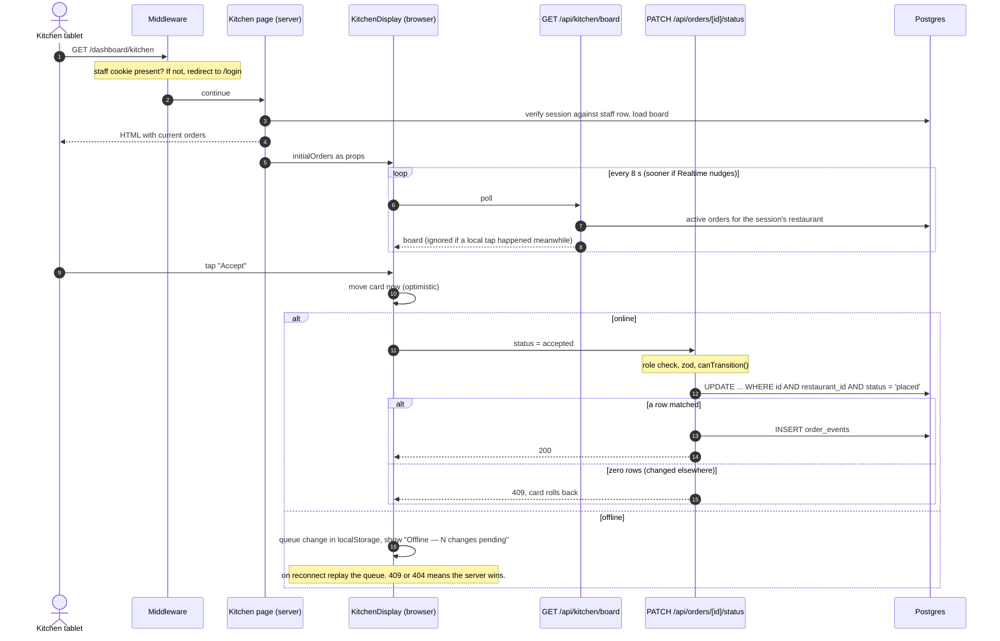
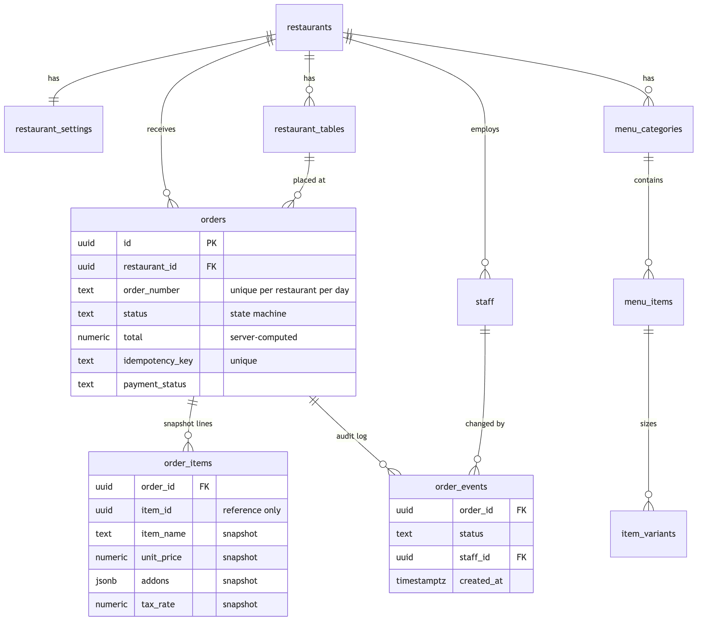
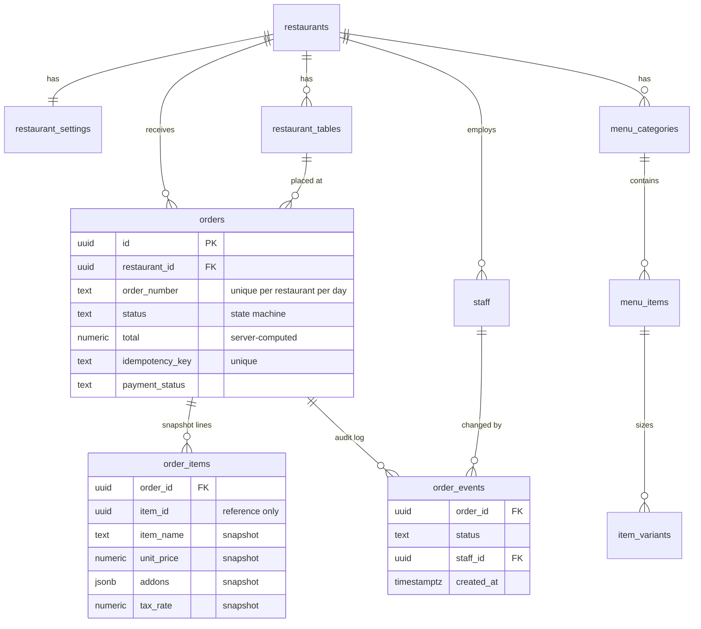

# QBite Architecture

QBite is a multi-tenant QR ordering platform: diners scan a table QR, order from their phone without an app or login, and the order appears on the kitchen display. One deployment serves many restaurants.

This document shows how the pieces fit together. The *why* behind each design choice is in the [Architecture Decision Records](adr/README.md); links to them are inline.

The complete set of UML diagrams (use case, class, component, deployment, state machine, activity, and sequence diagrams for diners, kitchen staff and owners) is in [uml.md](uml.md).

---

## 1. System context

Mermaid source

**Trust boundaries**

- The **server** holds the Supabase service-role key, the Razorpay secret and the Anthropic key. None of them ever reach the browser.
- The **browser** holds only the Supabase anon key, which RLS restricts.
- Because the service role bypasses RLS, every server query is filtered by a `restaurant_id` that the server derives itself — from the URL slug for diners, from the verified session for staff. See [ADR 0001](adr/0001-shared-database-multi-tenancy.md).

**Where code runs**

| Runs on the server | Runs in the browser |
|---|---|
| `middleware.ts`, every `page.tsx` without `'use client'`, every `app/api/**/route.ts`, everything in `src/lib/` except shared pure helpers | Components marked `'use client'`: menu, cart, checkout form, kitchen display, dashboards |
| Shared by both: `src/lib/pricing.ts` (money math) and `src/types/index.ts` (types and the order state machine) | |

---

## 2. Order lifecycle

- Transitions are defined once (`ORDER_FLOW` in `src/types/index.ts`) and used by both the API and the kitchen UI.
- Any other transition is rejected with **409**. An update only applies if the order is still in the status it was validated against (compare-and-set), so two devices can't overwrite each other.
- Every change appends a row to `order_events`.

See [ADR 0004](adr/0004-order-state-machine.md).

---

## 3. Flow: a diner places an order

Mermaid source

Key points:
- **The client never sets a price.** The cart's total is for display. The server reprices every line from the database and snapshots name, price, add-ons and tax rate into `order_items` ([ADR 0002](adr/0002-server-side-pricing-and-snapshots.md)).
- **Exactly one order per cart.** The idempotency key plus a unique constraint collapses double-taps, retries and concurrent duplicates into a single order ([ADR 0003](adr/0003-idempotent-order-creation.md)).
- **Daily order numbers** (`ORD-0042`) are allocated inside the same transaction under a per-restaurant advisory lock ([ADR 0005](adr/0005-daily-order-numbers.md)).
- **Payment state changes only from the verified webhook**, never from the browser's "payment succeeded" callback.

---

## 4. Flow: the kitchen advances an order

Why polling, not Realtime: Supabase Realtime filters rows through RLS using `auth.uid()`. Staff sign in with a signed cookie (to support PIN login on shared tablets), so to the database the browser is anonymous and receives nothing. A server route that reads with the service role and scopes to the session's restaurant is the reliable path. Realtime is kept only to trigger an earlier poll. See [ADR 0006](adr/0006-staff-sessions.md), [ADR 0007](adr/0007-kitchen-board-polling.md) and [ADR 0008](adr/0008-offline-kitchen-display.md).

---

## 5. Core data model

Mermaid source

Every tenant table carries `restaurant_id`. Money is `numeric(10,2)`. Add-on groups, service requests and group-ordering sessions are omitted for clarity; the full schema is in [`schema.sql`](schema.sql).

---

## 6. Scale: where it breaks first

These are estimates with stated assumptions, not measurements.

**Assumptions:** 1,000 restaurants, one kitchen screen each, 60 orders per restaurant in the peak hour, 10,000 diners with an order tracker open at peak.

| Load | Calculation | Rate |
|---|---|---|
| Order writes | 1,000 × 60 / 3,600 s | **~17 orders/s** |
| Kitchen board polls | 1,000 screens ÷ 8 s | **~125 reads/s** |
| Order tracker polls | 10,000 diners ÷ 15 s | **~670 reads/s** |

**Reads from polling outweigh writes by roughly 50 to 1.** Order creation (a handful of queries and one transaction) is not the bottleneck; idle screens asking "anything new?" are.

What to do, in order of effort:
1. **Skip unchanged boards.** Return 304 or an empty diff when the restaurant's latest `order_events` row hasn't changed since the client's last poll.
2. **Cache per restaurant for 1–2 s**, so ten screens in one restaurant cost one query.
3. **Push instead of poll.** Server-Sent Events from a process holding the service role, fanning out per restaurant. This replaces most polling traffic.
4. **Read replica** for reports and dashboards, keeping the primary for order writes.

Other limits to know:
- **Rate limits use Redis (Upstash)** when `UPSTASH_REDIS_REST_*` is set, so every serverless instance shares one counter. If Redis is down or slow (over 1 s), a request falls back to a per-instance in-memory limit and logs it: weaker for a moment, never unlimited, and an outage never blocks ordering.
- **Database connections.** `supabase-js` talks to Postgres over HTTP through PostgREST, which pools connections, so serverless fan-out doesn't open a Postgres connection per function instance.
- **Order-number lock.** Serialised per restaurant only. Contention is one restaurant's simultaneous checkouts, never platform-wide.
- **Noisy tenants.** All restaurants share one database. A very large tenant can be moved to its own project later; the `restaurant_id` column makes that mechanical.

---

## 7. Failure modes

| Failure | What the user sees | Why it's safe |
|---|---|---|
| Diner double-taps "Place order" or the request is retried | One order | Idempotency key + unique constraint ([0003](adr/0003-idempotent-order-creation.md)) |
| Tampered request with a fake total | Real price charged | Server reprices from the database ([0002](adr/0002-server-side-pricing-and-snapshots.md)) |
| Two devices change the same order | Second gets 409 and refreshes | Compare-and-set on status ([0004](adr/0004-order-state-machine.md)) |
| Kitchen wifi drops | "Offline — N changes pending"; work continues | Persisted queue, server wins on sync ([0008](adr/0008-offline-kitchen-display.md)) |
| Razorpay webhook replayed or forged | No effect | HMAC verified before any write; replays find the order already updated |
| Staff member removed mid-shift | Signed out on next request | Session checked against the staff row every request ([0006](adr/0006-staff-sessions.md)) |
| Supabase unreachable | Sign-in says "temporarily unavailable" (503); `/api/health` returns 503 for the uptime monitor | Outage isn't reported as wrong credentials |
| Claude API down or slow | AI import errors clearly; "Ask AI" fails gracefully; ordering unaffected | AI is optional and never in the order path ([0009](adr/0009-ai-as-untrusted-component.md)) |
| Server instance restarts | Nothing visible | Stateless servers; only in-memory rate-limit counters reset |

---

## 8. Known gaps

Stated in the ADRs, collected here:
- The status update and its `order_events` insert are separate statements, not one transaction ([0004](adr/0004-order-state-machine.md)).
- The order-number business day is UTC, so in India numbers reset at 05:30 local time ([0005](adr/0005-daily-order-numbers.md)).
- Kitchen and tracker polling is the first scaling limit (section 6).
- Rate limits are per instance only while Redis is unconfigured or unreachable.
