# QBite UML Diagrams

UML views of the system, drawn in Mermaid so they render on GitHub and stay next to the code. They complement [architecture.md](architecture.md), which already holds the **sequence**, **state machine** and **ER** diagrams:

| UML diagram | Where |
|---|---|
| Use case | [§1](#1-use-case-diagram) |
| Class (domain model) | [§2](#2-class-diagram--domain-model) |
| Class (server modules) | [§3](#3-class-diagram--server-modules) |
| Component | [§4](#4-component-diagram) |
| Activity (place an order) | [§5](#5-activity-diagram--post-apiorders) |
| Activity (Razorpay webhook) | [§6](#6-activity-diagram--razorpay-webhook) |
| Deployment | [§7](#7-deployment-diagram) |
| State machine (order) | [architecture.md §2](architecture.md#2-order-lifecycle) |
| Sequence (place order, kitchen) | [architecture.md §3–4](architecture.md#3-flow-a-diner-places-an-order) |
| Entity relationship | [architecture.md §5](architecture.md#5-core-data-model) |

Mermaid has no native use case or deployment syntax, so those two use flowchart notation: stick-figure actors become 👤 nodes, use cases become rounded nodes, and nodes/execution environments become nested boxes.

---

## 1. Use case diagram

Who can do what. Staff roles nest: a manager can do everything a waiter or kitchen user can, and an owner everything a manager can (enforced by `requireRole()` in `src/lib/auth.ts` and the `roles` lists in `DashboardNav.tsx`).

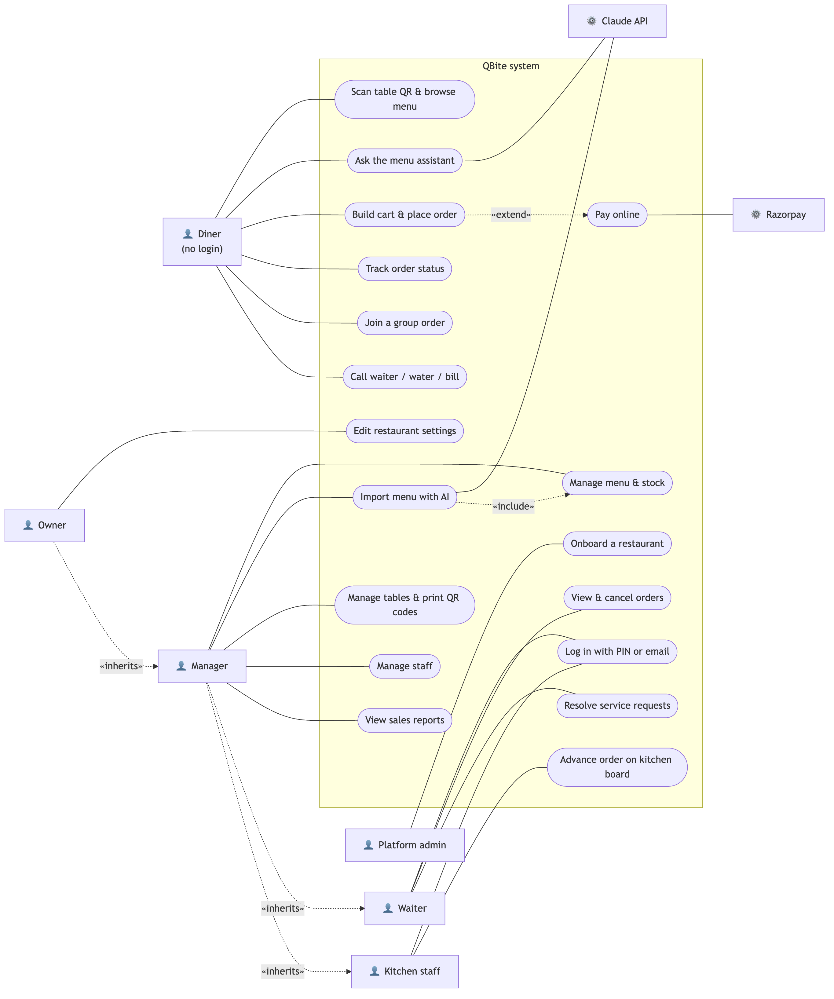

Mermaid source

---

## 2. Class diagram — domain model

The types in `src/types/index.ts`, which mirror `docs/schema.sql`. Fields are trimmed to the ones that matter for behaviour. A few things the diagram shows:
- `OrderItem` holds **no reference to price data** in `MenuItem`. It is a snapshot ([ADR 0002](adr/0002-server-side-pricing-and-snapshots.md)).
- `CartLine` and `PriceBreakdown` are client/compute shapes, not tables.
- Every tenant-owned class carries `restaurantId`.

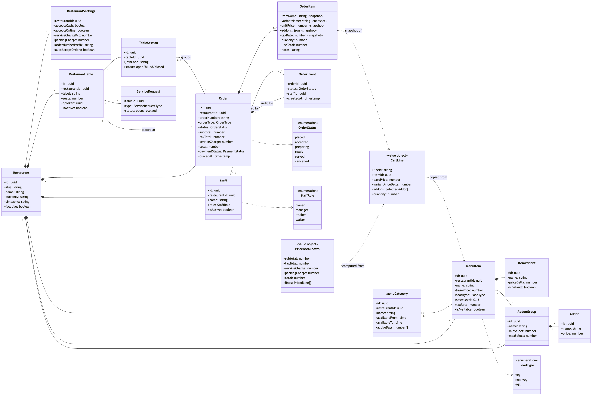

Mermaid source

---

## 3. Class diagram — server modules

The modules are plain TypeScript modules, not classes, so each box is drawn as a «module» with its exported functions. Arrows are "uses" dependencies. The important property is direction: route handlers depend on `lib/`, `lib/` never depends on routes, and **only `pricing.ts` does money arithmetic**.

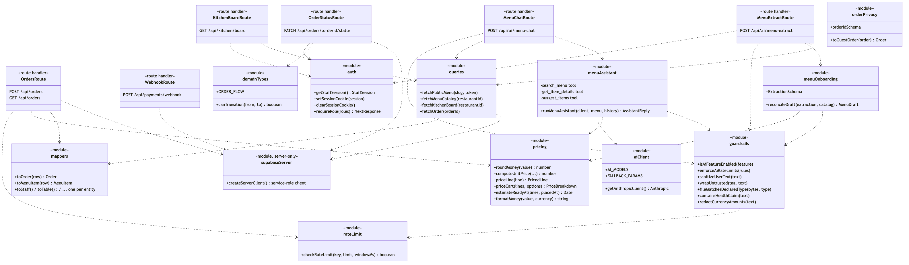

Mermaid source

```mermaid
classDiagram
  direction TB

  class OrdersRoute {
    <<route handler>>
    POST /api/orders
    GET /api/orders
  }
  class OrderStatusRoute {
    <<route handler>>
    PATCH /api/orders/:orderId/status
  }
  class KitchenBoardRoute {
    <<route handler>>
    GET /api/kitchen/board
  }
  class MenuChatRoute {
    <<route handler>>
    POST /api/ai/menu-chat
  }
  class MenuExtractRoute {
    <<route handler>>
    POST /api/ai/menu-extract
  }
  class WebhookRoute {
    <<route handler>>
    POST /api/payments/webhook
  }

  class pricing {
    <<module>>
    +roundMoney(value) number
    +computeUnitPrice(...) number
    +priceLine(line) PricedLine
    +priceCart(lines, options) PriceBreakdown
    +estimateReadyAt(lines, placedAt) Date
    +formatMoney(value, currency) string
  }
  class auth {
    <<module>>
    +getStaffSession() StaffSession
    +setSessionCookie(session)
    +clearSessionCookie()
    +requireRole(roles) NextResponse
  }
  class rateLimit {
    <<module>>
    +checkRateLimit(key, limit, windowMs) boolean
  }
  class orderPrivacy {
    <<module>>
    +orderIdSchema
    +toGuestOrder(order) Order
  }
  class mappers {
    <<module>>
    +toOrder(row) Order
    +toMenuItem(row) MenuItem
    +toStaff() / toTable() / ... one per entity
  }
  class domainTypes {
    <<module>>
    +ORDER_FLOW
    +canTransition(from, to) boolean
  }
  class queries {
    <<module>>
    +fetchPublicMenu(slug, token)
    +fetchMenuCatalog(restaurantId)
    +fetchKitchenBoard(restaurantId)
    +fetchOrder(orderId)
  }
  class supabaseServer {
    <<module, server-only>>
    +createServerClient() service-role client
  }
  class guardrails {
    <<module>>
    +isAiFeatureEnabled(feature)
    +enforceAiRateLimits(rules)
    +sanitizeUserText(text)
    +wrapUntrusted(tag, text)
    +fileMatchesDeclaredType(bytes, type)
    +containsHealthClaim(text)
    +redactCurrencyAmounts(text)
  }
  class menuAssistant {
    <<module>>
    +runMenuAssistant(client, menu, history) AssistantReply
    -search_menu tool
    -get_item_details tool
    -suggest_items tool
  }
  class menuOnboarding {
    <<module>>
    +ExtractionSchema
    +reconcileDraft(extraction, catalog) MenuDraft
  }
  class aiClient {
    <<module>>
    +getAnthropicClient() Anthropic
    +AI_MODELS
    +FALLBACK_PARAMS
  }

  OrdersRoute ..> rateLimit
  OrdersRoute ..> pricing
  OrdersRoute ..> mappers
  OrdersRoute ..> supabaseServer
  OrderStatusRoute ..> auth
  OrderStatusRoute ..> domainTypes
  OrderStatusRoute ..> supabaseServer
  KitchenBoardRoute ..> auth
  KitchenBoardRoute ..> queries
  MenuChatRoute ..> guardrails
  MenuChatRoute ..> queries
  MenuChatRoute ..> menuAssistant
  MenuExtractRoute ..> auth
  MenuExtractRoute ..> guardrails
  MenuExtractRoute ..> menuOnboarding
  MenuExtractRoute ..> queries
  WebhookRoute ..> supabaseServer
  menuAssistant ..> aiClient
  menuAssistant ..> pricing
  menuAssistant ..> guardrails
  menuOnboarding ..> pricing
  menuOnboarding ..> guardrails
  guardrails ..> rateLimit
  queries ..> mappers
  queries ..> supabaseServer
```

---

## 4. Component diagram

The deployable pieces and the interfaces between them. The dashed boundary is the trust boundary: everything in the browser is untrusted, and the service-role key exists only inside the server components.

Mermaid source

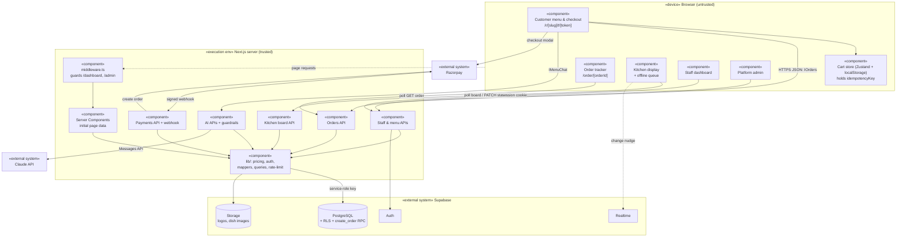

---

## 5. Activity diagram — `POST /api/orders`

Every decision the route makes, in order (`src/app/api/orders/route.ts`, "Step 1" to "Step 9"). Swimlanes: the route handler and Postgres. Note the two idempotency exits that both return **200** with the existing order.

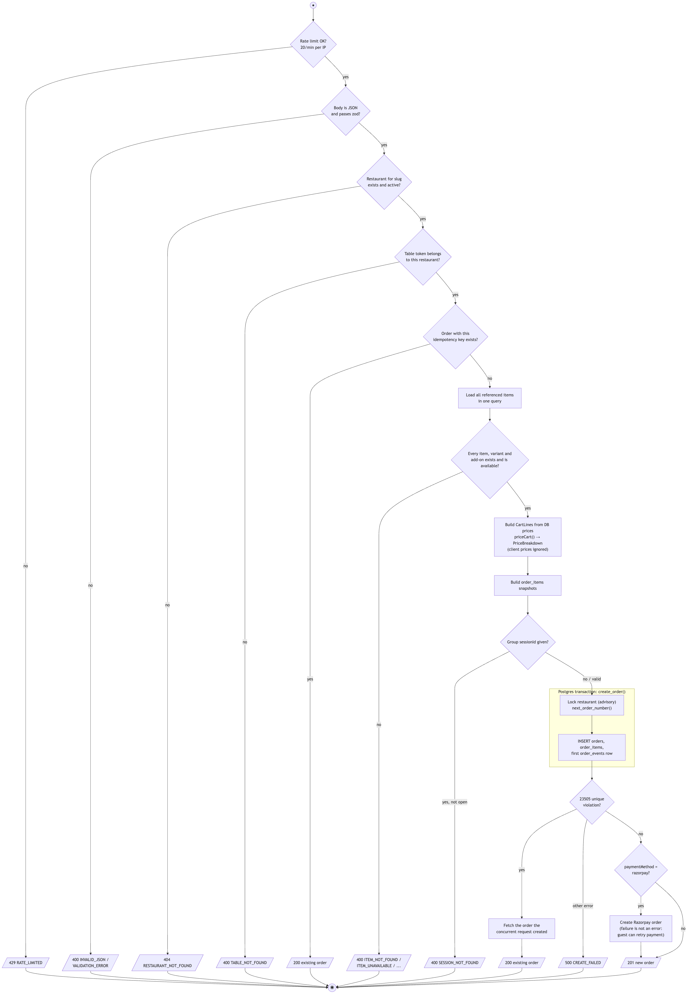

Mermaid source

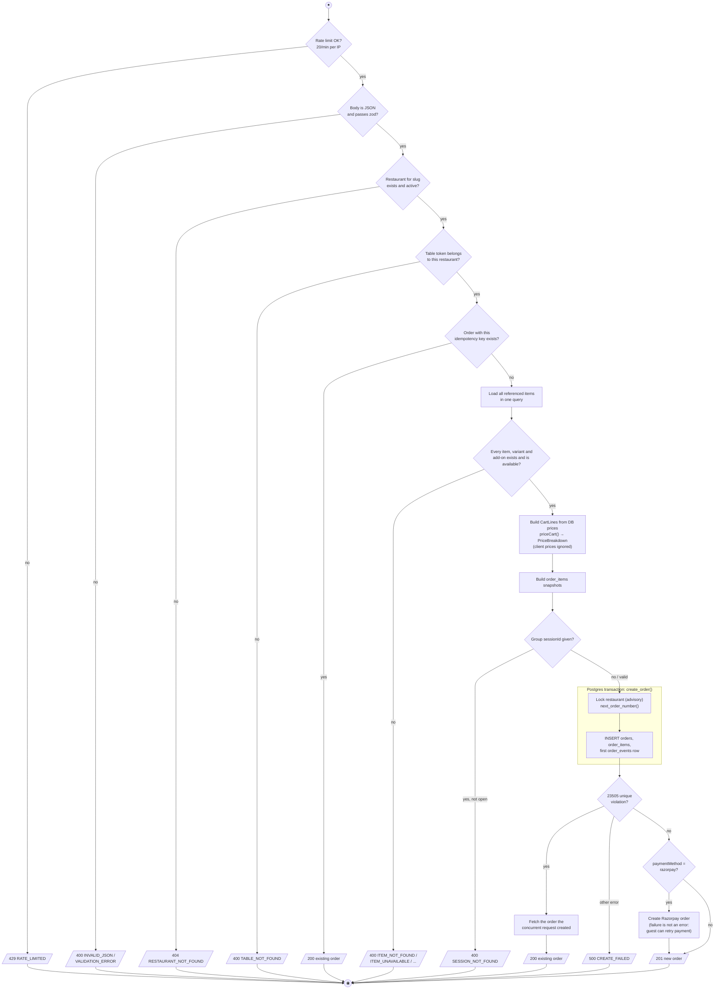

---

## 6. Activity diagram — Razorpay webhook

Payment state only changes after the signature is verified, and the handler is safe to receive the same event twice: a replay finds the row by its updated `payment_ref` and sees it is already paid (`src/app/api/payments/webhook/route.ts`).

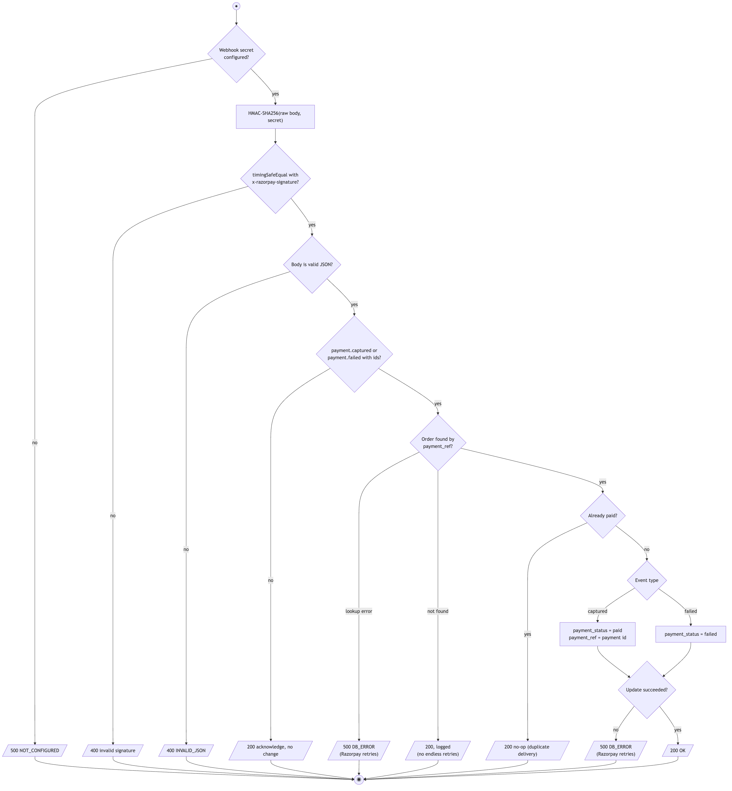

Mermaid source

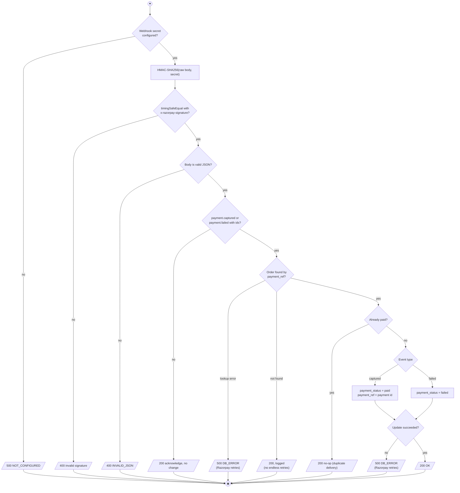

The response codes are deliberate: a **500 asks Razorpay to retry** (used when a captured payment could be lost), while a 200 stops retries for events that can never succeed.

---

## 7. Deployment diagram

Where each piece runs in production.

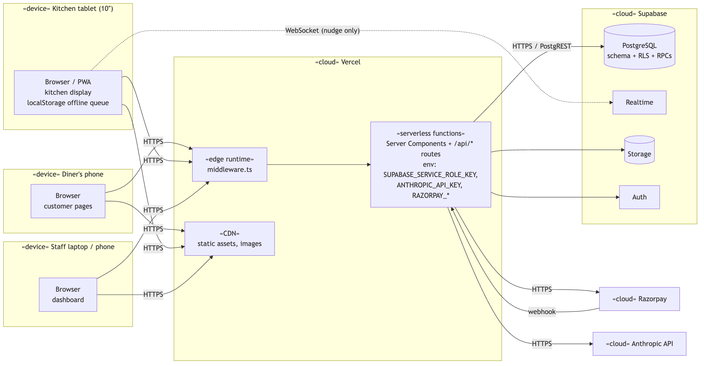

Mermaid source

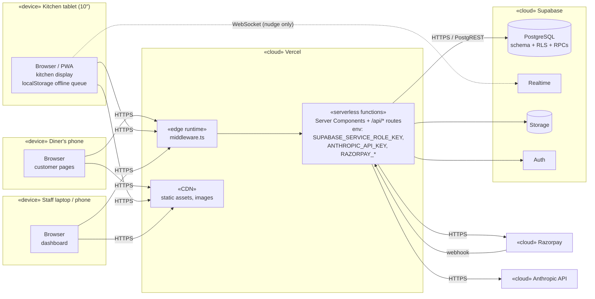

**Deployment notes**
- Secrets live only in Vercel's server environment. `NEXT_PUBLIC_*` variables (Supabase URL, anon key, Razorpay key id) are the only values shipped to browsers.
- Serverless instances don't share memory, so the in-memory rate limiter in `src/lib/rate-limit.ts` is per instance. Moving it to Redis is listed in [architecture.md §8](architecture.md#8-known-gaps).
