# QBite UML Diagrams

Every UML view of the system in one place, drawn in Mermaid so it renders on GitHub and stays next to the code. The diagrams follow the usual UML order: **requirements** (what the system does for whom), **structure** (what it is made of) and **behaviour** (what happens over time). For the narrative, scaling limits and failure modes, see [architecture.md](architecture.md).

| # | Diagram | UML type |
|---|---|---|
| | **Part 1 — Requirements** | |
| [1](#1-use-case-diagram) | Actors and what they can do | Use case |
| | **Part 2 — Structure** | |
| [2](#2-class-diagram--domain-model) | Domain model | Class |
| [3](#3-class-diagram--server-modules) | Server modules | Class |
| [4](#4-component-diagram) | Browser, server and external systems | Component |
| [5](#5-deployment-diagram) | Where it runs in production | Deployment |
| | **Part 3 — Behaviour** | |
| [6](#6-state-machine--order-lifecycle) | Order lifecycle | State machine |
| [7](#7-activity-diagram--post-apiorders) | `POST /api/orders` | Activity |
| [8](#8-activity-diagram--razorpay-webhook) | Razorpay webhook | Activity |
| [9.1](#91-diner-places-an-order) | Diner places an order | Sequence |
| [9.2](#92-kitchen-advances-an-order) | Kitchen advances an order | Sequence |
| [9.3](#93-owner-login-and-session) | Owner login and session | Sequence |
| [9.4](#94-ai-menu-import) | AI menu import | Sequence |
| [9.5](#95-owner-marks-a-dish-out-of-stock) | Owner marks a dish out of stock | Sequence |
| [A](#appendix--data-model-er) | Data model | ER (not UML) |

Mermaid has no native use case or deployment syntax, so those two use flowchart notation: actors become 👤 nodes, use cases become rounded nodes, and nodes/execution environments become nested boxes.

---

## Part 1 — Requirements

### 1. Use case diagram

Who can do what. Staff roles nest: a manager can do everything a waiter or kitchen user can, and an owner everything a manager can (enforced by `requireRole()` in `src/lib/auth.ts` and the `roles` lists in `DashboardNav.tsx`).

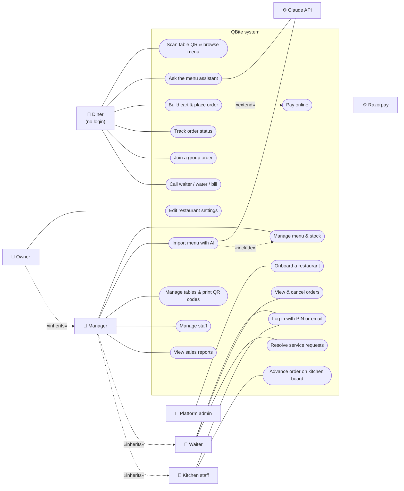

---

## Part 2 — Structure

How the system is built: the data it holds, the code that handles it, and where it runs.

### 2. Class diagram — domain model

The types in `src/types/index.ts`, which mirror `docs/schema.sql`. Fields are trimmed to the ones that matter for behaviour. A few things the diagram shows:
- `OrderItem` holds **no reference to price data** in `MenuItem`. It is a snapshot ([ADR 0002](adr/0002-server-side-pricing-and-snapshots.md)).
- `CartLine` and `PriceBreakdown` are client/compute shapes, not tables.
- Every tenant-owned class carries `restaurantId`.

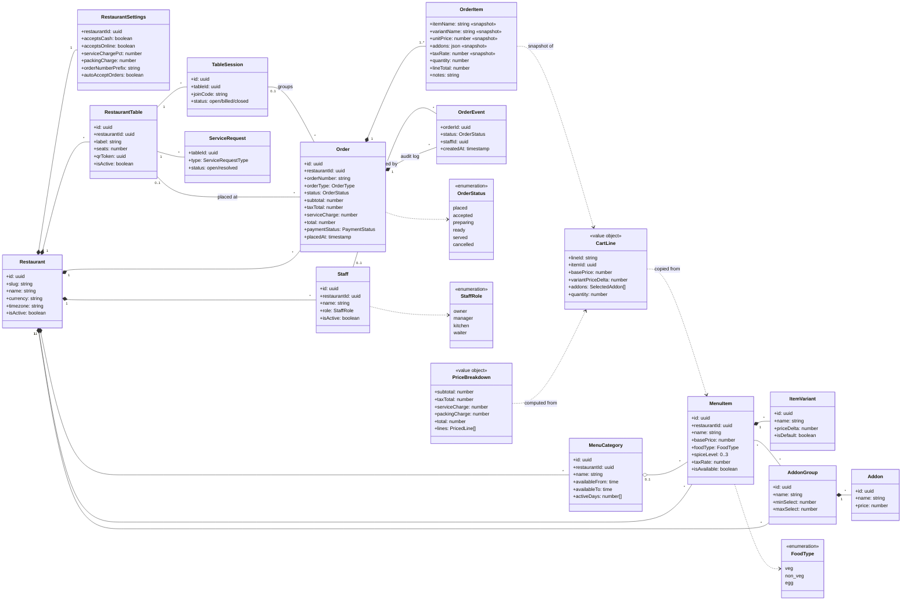

### 3. Class diagram — server modules

The modules are plain TypeScript modules, not classes, so each box is drawn as a «module» with its exported functions. Arrows are "uses" dependencies. The important property is direction: route handlers depend on `lib/`, `lib/` never depends on routes, and **only `pricing.ts` does money arithmetic**.

### 4. Component diagram

The deployable pieces and the interfaces between them. The dashed boundary is the trust boundary: everything in the browser is untrusted, and the service-role key exists only inside the server components.

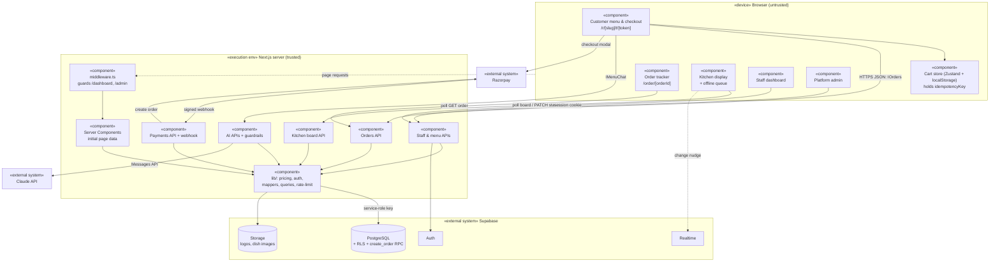

### 5. Deployment diagram

Where each piece runs in production.

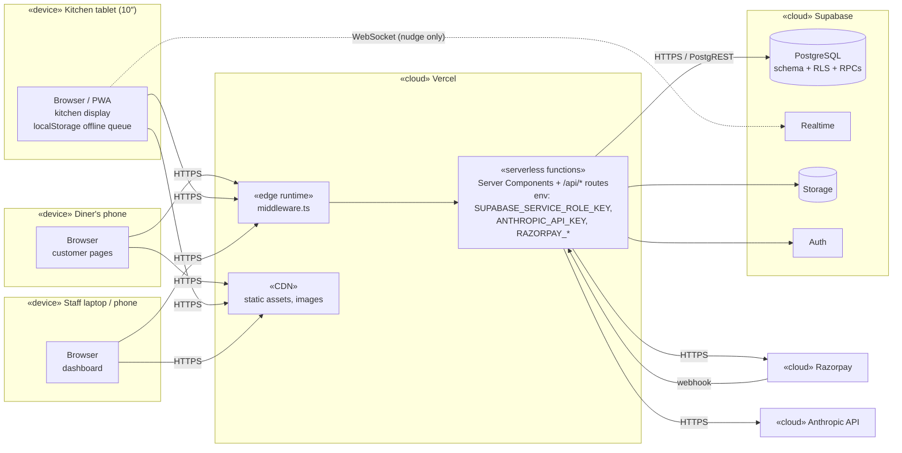

**Deployment notes**
- Secrets live only in Vercel's server environment. `NEXT_PUBLIC_*` variables (Supabase URL, anon key, Razorpay key id) are the only values shipped to browsers.
- Serverless instances don't share memory, so the in-memory rate limiter in `src/lib/rate-limit.ts` is per instance. Moving it to Redis is listed in [architecture.md §8](architecture.md#8-known-gaps).

---

## Part 3 — Behaviour

How the system acts over time: the life of an order, the decisions a request goes through, and who talks to whom.

### 6. State machine — order lifecycle

Transitions are defined once, in `ORDER_FLOW` (`src/types/index.ts`), and used by both the API and the kitchen UI. Any other transition is rejected with **409**. An update applies only if the order is still in the status it was checked against (compare-and-set), and every change appends a row to `order_events` ([ADR 0004](adr/0004-order-state-machine.md)).

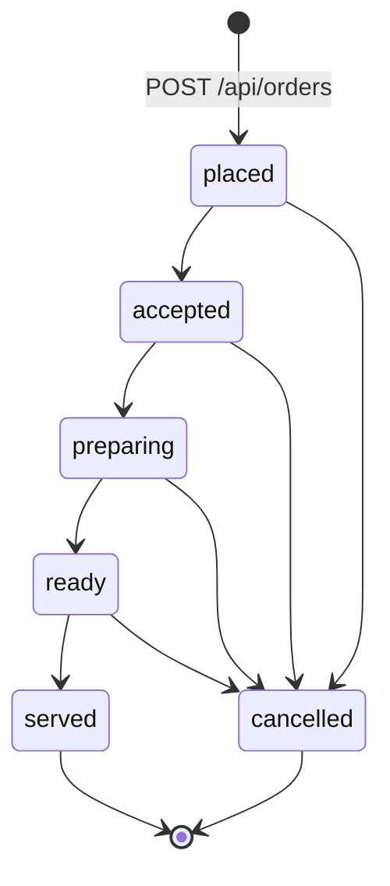

### 7. Activity diagram — `POST /api/orders`

Every decision the route makes, in order (`src/app/api/orders/route.ts`, "Step 1" to "Step 9"). Swimlanes: the route handler and Postgres. Note the two idempotency exits that both return **200** with the existing order.

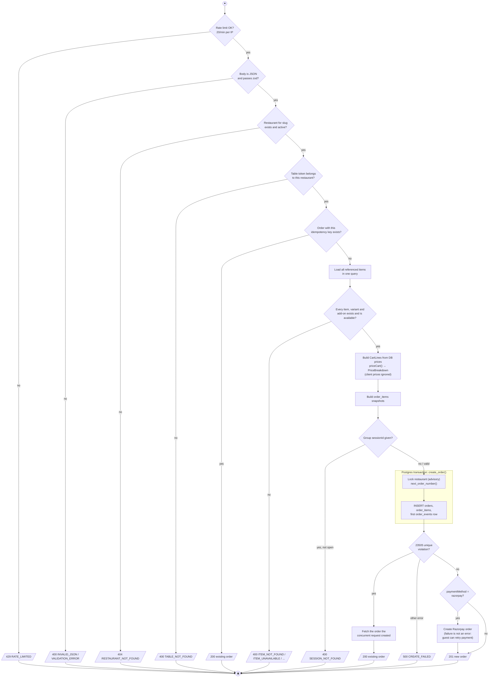

### 8. Activity diagram — Razorpay webhook

Payment state only changes after the signature is verified, and the handler is safe to receive the same event twice: a replay finds the row by its updated `payment_ref` and sees it is already paid (`src/app/api/payments/webhook/route.ts`).

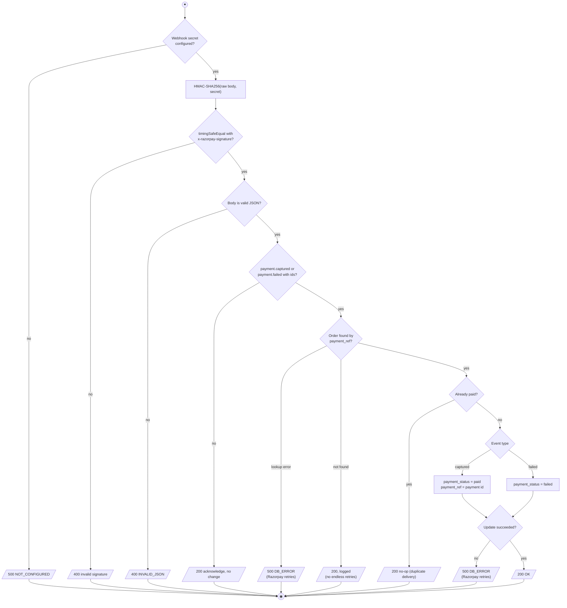

The response codes are deliberate: a **500 asks Razorpay to retry** (used when a captured payment could be lost), while a 200 stops retries for events that can never succeed.

### 9. Sequence diagrams

Five flows, grouped by who starts them. The step-by-step reasoning for 9.1 and 9.2 is in [architecture.md §3–4](architecture.md#3-flow-a-diner-places-an-order).

#### 9.1 Diner places an order

Server-side repricing, the idempotency fast path and race backstop, payment, and the order tracker ([ADR 0002](adr/0002-server-side-pricing-and-snapshots.md), [ADR 0003](adr/0003-idempotent-order-creation.md)).

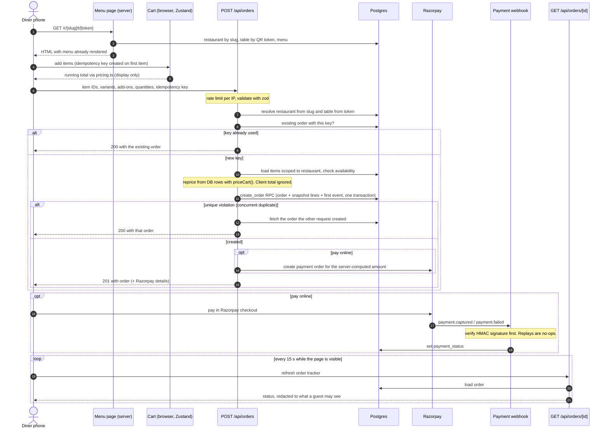

#### 9.2 Kitchen advances an order

Tenant-scoped polling with Realtime only as a nudge, an optimistic tap, and a compare-and-set update ([ADR 0007](adr/0007-kitchen-board-polling.md), [ADR 0008](adr/0008-offline-kitchen-display.md)).

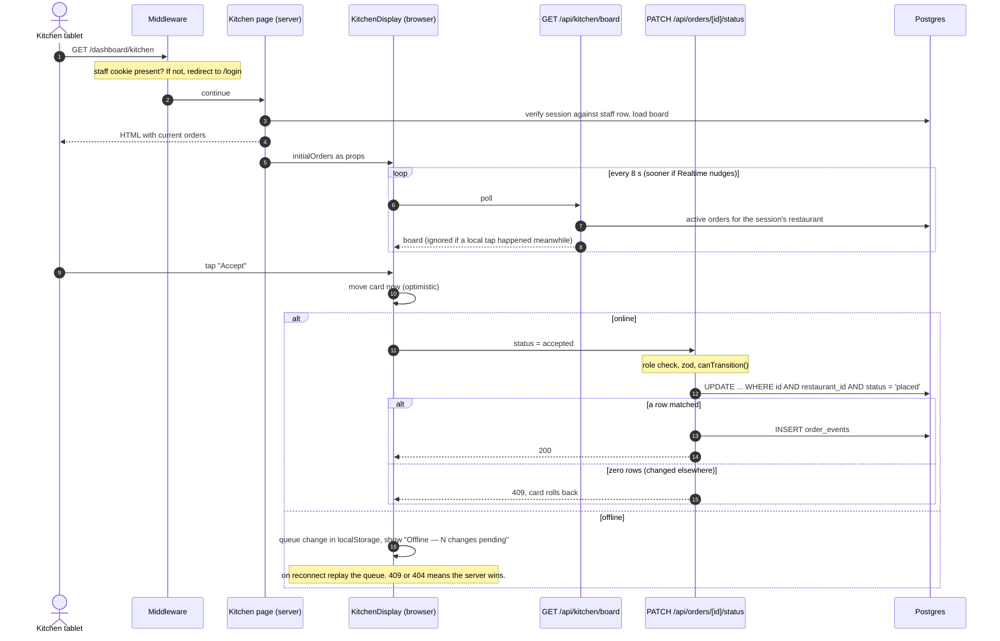

#### 9.3 Owner login and session

Email login goes through Supabase Auth, but the session the app trusts is its own signed cookie. Middleware only checks that the cookie **exists**. The signature and the staff row are checked on **every** server request, so a removed or demoted staff member loses access right away (`src/app/api/auth/login/route.ts`, `src/lib/auth.ts`, `src/middleware.ts`; [ADR 0006](adr/0006-staff-sessions.md)).

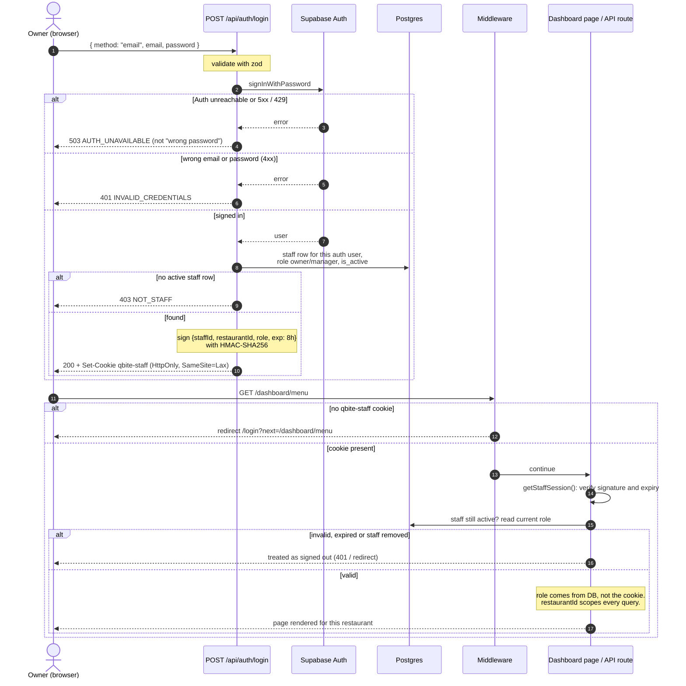

#### 9.4 AI menu import

The model only drafts. Code checks the request before the model is called and checks the result after. The owner fixes anything uncertain, and the save goes through the same menu APIs and validation as a hand-made dish (`src/app/api/ai/menu-extract/route.ts`, `MenuExtractDialog.tsx`; [ADR 0009](adr/0009-ai-as-untrusted-component.md)).

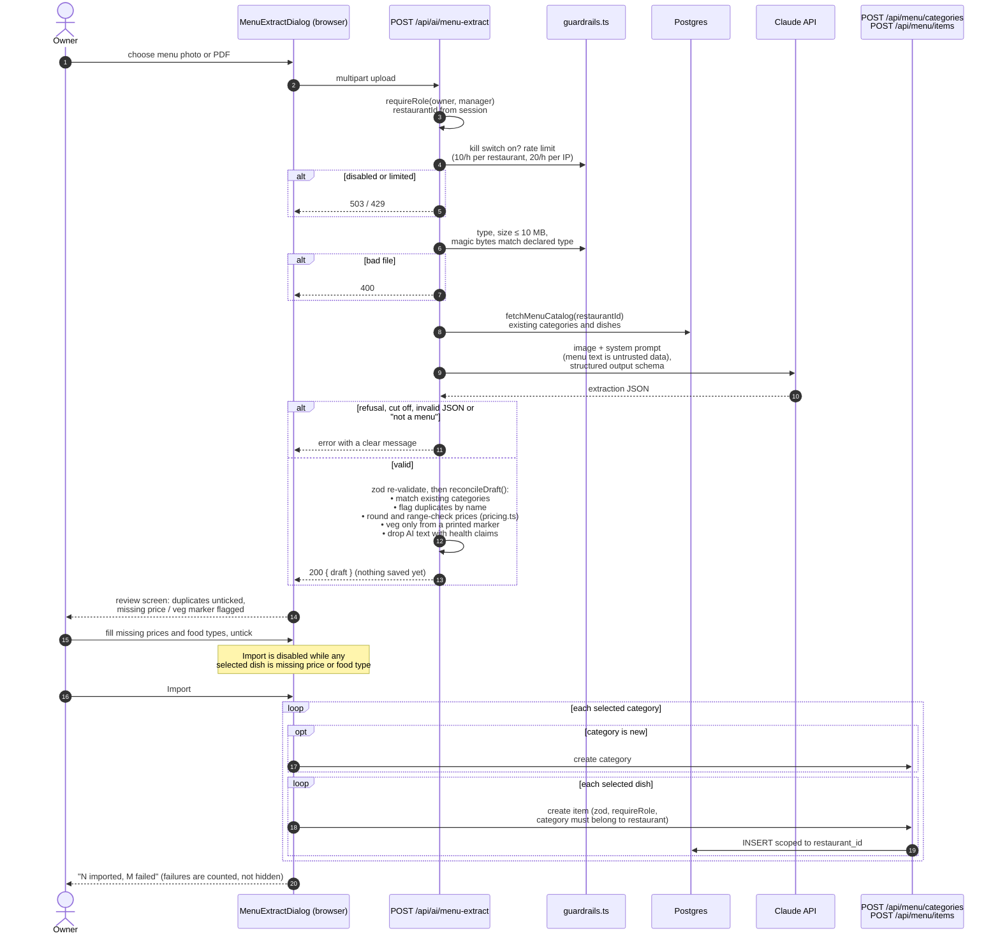

#### 9.5 Owner marks a dish out of stock

The toggle is optimistic and rolls back if the request fails. Diners see the change on their next menu load. A diner who already has the dish in their cart can't order it, because order creation re-checks availability on the server (`ItemList.tsx`, `src/app/api/menu/items/[id]/route.ts`, `src/app/api/orders/route.ts`).

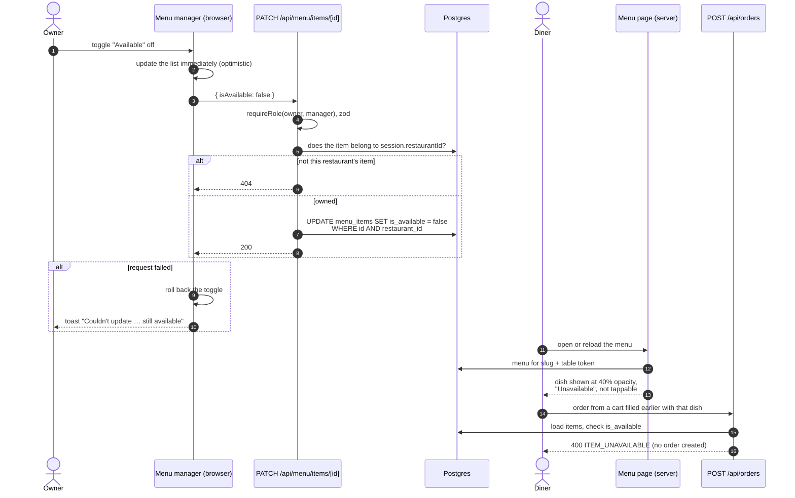

---

## Appendix — Data model (ER)

Not a UML diagram, but the class diagram in §2 maps onto these tables. Full version with notes: [architecture.md §5](architecture.md#5-core-data-model).

